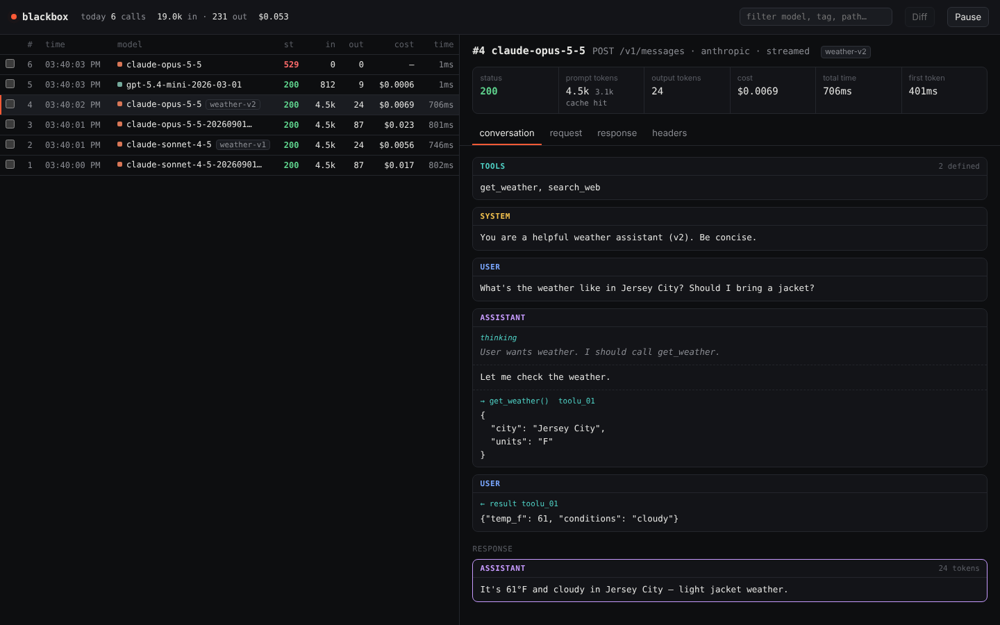

# blackbox

A local flight recorder for LLM API calls. Point your SDK at it, and every request and response to Anthropic or OpenAI is passed through untouched and logged to SQLite. A small web UI lets you browse calls, read them as conversations, and diff two runs side by side.



## Why

LLM calls are invisible and non-deterministic. When an agent goes off the rails on call 11 of 15, you usually can't see what was actually sent. blackbox sits at the network layer, so it sees the real payload no matter which framework built it:

- **Debug agents.** Step through every call in a run: system prompt, history, tool definitions, tool calls and results.
- **See what your framework sends.** Hidden template text, retries, extra calls.
- **Compare prompt versions.** Diff two calls to see the prompt change, the output change, and the token, cost and latency deltas together.
- **Find where the money went.** Per-call cost, daily totals, and tags to group runs.

## Quickstart

```sh
go install github.com/tinar9678/blackbox@latest   # needs Go 1.26+
blackbox
```

Then point your client at it:

```sh
export ANTHROPIC_BASE_URL=http://127.0.0.1:7878
export OPENAI_BASE_URL=http://127.0.0.1:7878/v1
```

Open http://127.0.0.1:7878 to watch calls arrive live.

### Record a coding agent

Coding agents make great test traffic: big system prompts, many tools, long multi-turn histories.

```sh
ANTHROPIC_BASE_URL=http://127.0.0.1:7878 claude
```

### In code

```python
import anthropic
client = anthropic.Anthropic(base_url="http://127.0.0.1:7878")
```

```python
from openai import OpenAI
client = OpenAI(base_url="http://127.0.0.1:7878/v1")
```

### Tag runs

Send an `X-Blackbox-Tag` header to group calls, for example one tag per experiment. It's stripped before the request goes upstream.

```python
client = anthropic.Anthropic(
    base_url="http://127.0.0.1:7878",
    default_headers={"X-Blackbox-Tag": "prompt-v2"},
)
```

Then filter by `prompt-v2` in the UI.

## How it works

- **Routing.** Requests carrying Anthropic headers (`anthropic-version` or `x-api-key`) go to `api.anthropic.com`, everything else to `api.openai.com`. You can also be explicit with a path prefix: `http://127.0.0.1:7878/anthropic` or `http://127.0.0.1:7878/openai/v1`.
- **Streaming.** Responses are forwarded byte for byte as they arrive, so streaming feels the same as without blackbox. The stream is recorded on the side and reassembled afterward, including text, thinking and tool calls.
- **Supported APIs.** Anthropic Messages, OpenAI Chat Completions and OpenAI Responses, streamed or not. Any other endpoint is still proxied and logged; it just won't get token or cost parsing.
- **Secrets.** `Authorization`, `x-api-key` and cookie headers are never written to disk.
- **Storage.** Everything lives in `~/.blackbox/blackbox.db`, a plain SQLite file you can query directly:

  ```sh
  sqlite3 ~/.blackbox/blackbox.db "select model, sum(cost_usd) from calls group by model"
  ```

## Pricing

Costs are computed from a built-in price table (USD per million tokens). Prices change, so check them against the [Anthropic](https://platform.claude.com/docs/en/about-claude/pricing) and [OpenAI](https://openai.com/api/pricing) pricing pages. To override a price or add a model, create `~/.blackbox/prices.json`. Keys are model id prefixes; the longest match wins.

```json
{
  "my-fine-tune": { "input": 3, "output": 12, "cache_read": 0.3, "cache_write": 0 }
}
```

Models with no known price show `—` instead of a guess.

## Flags

| flag | default | |
|---|---|---|
| `-addr` | `127.0.0.1:7878` | address to listen on |
| `-data` | `~/.blackbox` | where `blackbox.db` and `prices.json` live |
| `-anthropic-upstream` | `https://api.anthropic.com` | Anthropic base URL |
| `-openai-upstream` | `https://api.openai.com` | OpenAI base URL (any compatible API works) |
| `-max-body-mb` | `10` | max MB of each body to store; traffic itself is never cut |
| `-quiet` | `false` | don't print a line per call |

## Development

```sh
go test -race ./...
go run .
```

Pure Go (SQLite via `modernc.org/sqlite`), so it cross-compiles without a C toolchain. The UI is a single embedded HTML file in `ui/`.

## Roadmap

- [ ] Replay a recorded call, optionally against a different model or with an edited prompt
- [ ] Replay mode for tests: serve recorded responses instead of calling the API
- [ ] Group calls into runs automatically
- [ ] Export a call or run as JSON
- [ ] Prebuilt binaries for releases
